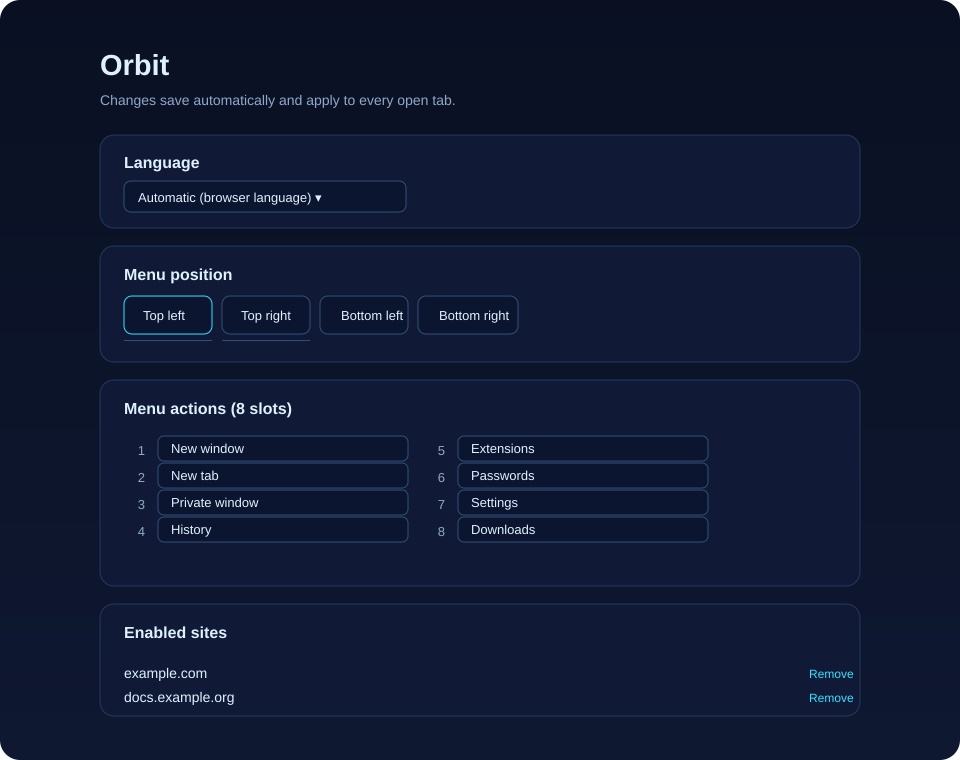

# Orbit

**Everything in your browser, one hover away.**

[](./LICENSE)
[](./manifest.json)
[](#overview-and-architecture)
[](https://github.com/M003aad/Orbit/actions/workflows/ci.yml)

## Table of Contents

- [Overview and Architecture](#overview-and-architecture)
- [Features](#features)
- [Screenshots](#screenshots)
- [Codebase Breakdown](#codebase-breakdown)
- [Permissions](#permissions)
- [Installation and Setup](#installation-and-setup)
- [Usage](#usage)
- [Messaging and API Reference](#messaging-and-api-reference)
- [Scripts](#scripts)
- [Contributing](#contributing)
- [Security](#security)
- [License](#license)

## Overview and Architecture

Orbit is a Chromium browser extension that puts a configurable radial menu on
websites you enable. It uses vanilla JavaScript, HTML, and CSS with Chrome
Extension Manifest V3; no framework or bundler is used. The extension targets
Google Chrome and Microsoft Edge.

The Manifest V3 background service worker handles browser actions and toolbar
state. A content script checks locally stored site and menu settings, then
renders the menu inside a closed Shadow DOM on enabled HTTP or HTTPS pages.
The options page lets users configure the menu and manage enabled sites.
Shared helpers and action definitions are in `shared.js`.

## Features

- Enable or disable Orbit for a website using the toolbar button or
  **Alt+Shift+O**. A saved hostname also enables its subdomains.
- Open an animated radial menu by hovering over its corner control; click its
  center to lock it open, and press **Escape** to close it.
- Choose eight menu actions and their order, select one of four screen corners,
  and choose automatic, English, or Arabic labels.
- Manage enabled hostnames in Options, including removing, exporting, or
  importing them as JSON.
- View an **ON** toolbar badge when Orbit is enabled for the active site.
- Hide the menu for the current site and hide the menu when printing.
- Use browser actions including new/duplicate/reopen/close tab, pin, mute,
  reload, open browser pages, and copy the current page URL.

Orbit stores enabled hostnames and settings in extension local storage. Its
content script is declared for all URLs, but the menu is shown only on enabled
HTTP and HTTPS sites; the browser blocks extensions on some internal pages and
stores. The menu does not read page content.

## Screenshots

UI previews based on the current extension interface:

### Radial menu


### Options page



## Codebase Breakdown

```text
Orbit/
├── .github/
│   ├── ISSUE_TEMPLATE/
│   │   ├── bug_report.md
│   │   └── feature_request.md
│   ├── workflows/
│   │   ├── ci.yml
│   │   └── release.yml
│   └── PULL_REQUEST_TEMPLATE.md
├── icons/
│   ├── icon-16.png
│   ├── icon-32.png
│   ├── icon-48.png
│   ├── icon-128.png
│   └── icon-256.png
├── docs/
│   └── screenshots/
│       ├── orbit-menu.svg
│       └── orbit-options.svg
├── scripts/
│   └── validate-extension.js
├── .editorconfig
├── .gitattributes
├── .gitignore
├── .prettierrc
├── background.js
├── CHANGELOG.md
├── CITATION.cff
├── content.js
├── CODE_OF_CONDUCT.md
├── CONTRIBUTING.md
├── eslint.config.js
├── LICENSE
├── logo.js
├── manifest.json
├── options.html
├── options.js
├── package-lock.json
├── package.json
├── README.md
├── SECURITY.md
├── shared.js
└── SUPPORT.md
```

| Path | Purpose |
| --- | --- |
| `manifest.json` | Manifest V3 metadata, permissions, extension entry points, and shortcut. |
| `background.js` | Service worker for toolbar state, keyboard command, and privileged browser actions. |
| `content.js` | Creates and updates the on-page radial menu. |
| `shared.js` | Shared actions, settings, localization, and hostname/storage helpers. |
| `logo.js` | Embeds the Orbit logo as a data URL. |
| `options.html`, `options.js` | Options page markup and settings/site management. |
| `icons/` | Toolbar and extension icons declared in the manifest. |
| `docs/screenshots/` | SVG previews of the radial menu and Options page. |
| `scripts/validate-extension.js` | Checks the manifest and referenced extension files. |
| `package.json`, `package-lock.json` | Development scripts and locked lint-tool dependencies. |
| `.github/` | Issue and pull request templates, CI, and release packaging workflows. |
| `README.md`, `CHANGELOG.md`, `CITATION.cff` | Project overview, release history, and citation metadata. |
| `CONTRIBUTING.md`, `CODE_OF_CONDUCT.md`, `SUPPORT.md`, `SECURITY.md` | Contributor, community, support, and vulnerability guidance. |
| `.editorconfig`, `.gitattributes`, `.gitignore`, `.prettierrc`, `eslint.config.js` | Editor, line-ending, ignore, formatting, and lint configuration. |
| `LICENSE` | GNU Affero General Public License version 3 terms. |

## Permissions

| Permission | Why it is needed |
| --- | --- |
| `storage` | Persists enabled hostnames and menu settings; migrates older site lists from sync storage when present. |
| `tabs` | Checks the active tab URL and performs actions such as duplicate, pin, mute, reload, and close. |
| `sessions` | Restores the most recently closed tab for the Reopen tab action. |

There are no `host_permissions`. The content script's `<all_urls>` match lets
the extension check whether the current site is enabled; Orbit only displays
its menu on supported HTTP and HTTPS pages that the user enabled. Browser
restrictions still prevent it from running on some internal pages and stores.

## Installation and Setup

1. Clone the repository:

   ```sh
   git clone https://github.com/M003aad/Orbit.git
   cd Orbit
   ```

2. Install the development dependencies:

   ```sh
   npm ci
   ```

3. Run the checks:

   ```sh
   npm run lint
   npm run build
   ```

   The build command validates the unpacked extension files; Orbit does not
   bundle or compile its source.

4. Open `chrome://extensions/` in Chrome or `edge://extensions/` in Edge.
5. Turn on **Developer mode**, select **Load unpacked**, and choose the Orbit
   project folder.
6. Pin Orbit to the toolbar if desired. After changing extension files, use
   **Reload** on its extensions page.

## Usage

1. Visit a regular website and click Orbit's toolbar button or press
   **Alt+Shift+O** to enable the site. Repeat to disable it. The **ON** badge
   indicates an enabled site.
2. Hover over the small control in the configured screen corner to open the
   radial menu. Select an action, or click the center logo to lock the menu
   open. Click the center again or press **Escape** to close it.
3. Open the extension's **Options** page to select the language and corner,
   choose and order eight actions, reset the action list, or remove/export/
   import enabled sites.

An enabled hostname applies to that hostname and its subdomains, not its parent
domain. The Private window action requires allowing Orbit in Incognito/private
mode in the browser's extension settings.

## Messaging and API Reference

The content script sends browser actions to the background service worker with
`chrome.runtime.sendMessage`. The service worker handles the `orbit-action`
message and responds asynchronously.

| Message | Direction | Payload | Response |
| --- | --- | --- | --- |
| `orbit-action` | Content script → service worker | `{ "type": "orbit-action", "action": "<action-id>" }` | Success: `{ "ok": true }`, optionally with a `note`; failure: `{ "ok": false, "error": "<error-code>" }`. |

`action` is one of `new-window`, `new-tab`, `private`, `history`,
`extensions`, `passwords`, `settings`, `downloads`, `bookmarks`, `reopen`,
`duplicate`, `pin`, `mute`, `reload`, or `close-tab`. The special `copy-url`
action is handled in the content script and does not use this message. Error
codes include `failed`, `incognito`, and `nothing-to-reopen`; a lost message
channel returns `reload-page` to the menu.

Orbit does not call external HTTP APIs or backend routes.

## Scripts

| Command | Purpose |
| --- | --- |
| `npm run lint` | Lints extension JavaScript and the manifest validator with ESLint. |
| `npm run build` | Validates the manifest and all paths it references; no bundling is performed. |

## Contributing

Bug reports, proposals, and focused code changes are welcome. See
[CONTRIBUTING.md](./CONTRIBUTING.md) for local setup and pull request guidance.

## Security

Please report vulnerabilities privately rather than in public issues. See
[SECURITY.md](./SECURITY.md) for reporting channels and response expectations.

## License

Orbit is licensed under the GNU Affero General Public License v3.0; see
[LICENSE](./LICENSE). Maintained by **M003aad**.
